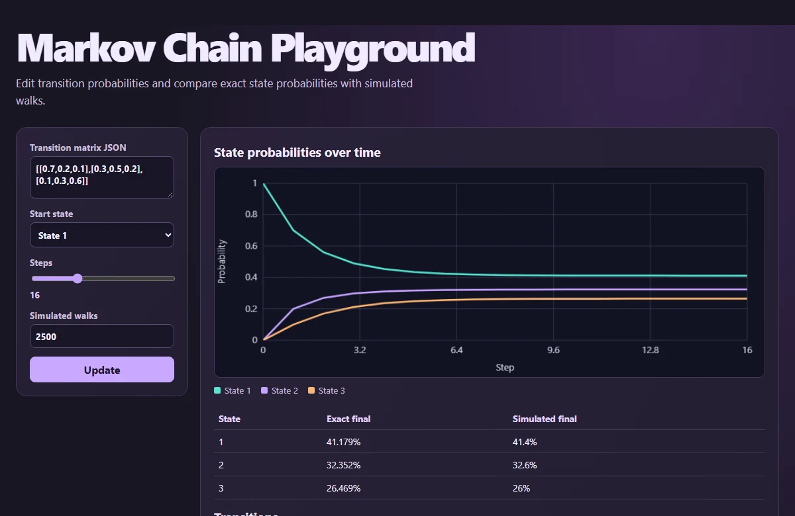

# Markov Chain Playground

Edit transition probabilities and compare exact state probabilities with simulated walks.

[Open the web app](https://surfingcoder.com/apps/markov-chain-playground/)



## Run locally

Serve the repository with Python 3, then open http://127.0.0.1:8000/ in a current browser.

```sh
python -m http.server 8000 --bind 127.0.0.1
```

Start with the provided example. Adjust the controls and select **Update** to recompute. Sliders refresh the result as you move them.

## Method

Each row specifies where the chain can go from its current state. Multiplication by the transition matrix advances the distribution one step. Simulated walks use a reproducible random seed.

## Verify

Run `node --test check.mjs` with Node.js 22 or newer. The check runs the app’s mathematical regression cases without a browser.
